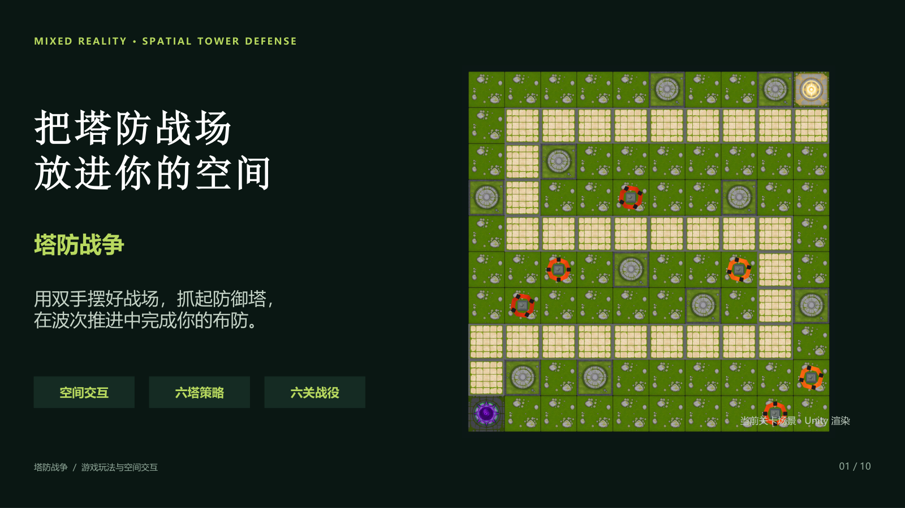
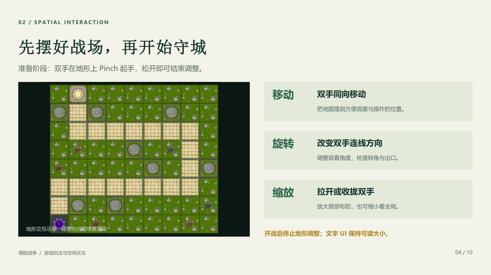
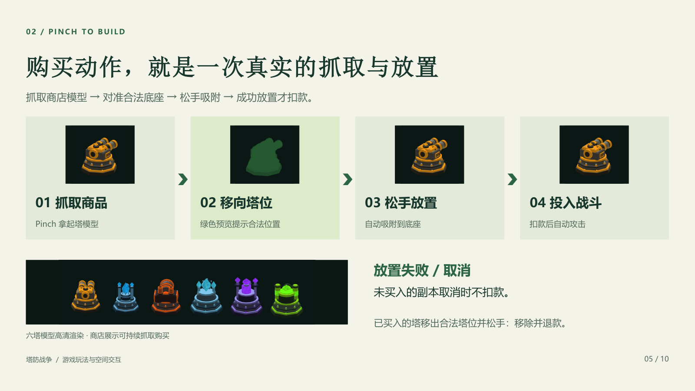
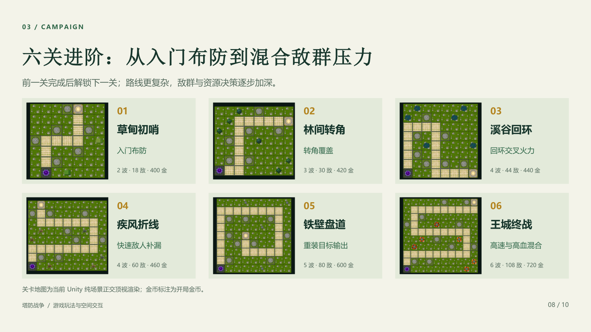

# 塔防战争 · TowerDefenseWar

**把塔防战场放进你的空间。**

塔防战争是一款基于 Unity 的混合现实（MR）空间塔防游戏。玩家用双手摆好战场，抓起商店中的防御塔并放到塔位，在敌人逐波推进的过程中调整布防、管理金币，守住基地。

**空间交互 · 六塔策略 · 六关战役**

> 核心体验：空间操作的直觉感 × 塔防布阵的策略性。
>
> [查看完整《游戏玩法与空间交互》PDF](PPT/%E5%A1%94%E9%98%B2%E6%88%98%E4%BA%89_%E6%B8%B8%E6%88%8F%E7%8E%A9%E6%B3%95%E4%B8%8E%E7%A9%BA%E9%97%B4%E4%BA%A4%E4%BA%92.pdf)

## 核心玩法

敌人沿固定道路向终点前进。击杀敌人获得金币；漏过的敌人会损伤基地。玩家需要结合路线覆盖、塔型搭配和购买时机，让每一笔金币变成有效火力。

1. **选择关卡**：进入战场，在准备阶段调整地图位置、角度与大小。
2. **布置防线**：触碰查看塔的信息，抓取商品并放到合法塔位。
3. **开始战斗**：敌人按波次出现，已放置的防御塔自动攻击。
4. **击杀获利**：把收入投入补塔，应对后续波次。
5. **完成关卡**：清除全部波次且基地仍有生命，即可获胜并解锁下一关。

当漏怪累计伤害使基地生命归零时，关卡失败。

## 空间交互

### 双手调整战场

准备阶段，双手在地形上做出 **Pinch（捏合）** 手势开始调整，松开即可结束。

| 操作 | 手势 | 用途 |
| --- | --- | --- |
| 移动 | 双手同向移动 | 把战场摆到便于观察和操作的位置 |
| 旋转 | 改变双手连线方向 | 检查路线转角、塔位与出口 |
| 缩放 | 拉开或收拢双手 | 放大局部布防，或缩小观察全局 |

开战后停止地形调整；文字 UI 保持可读大小。

### 抓取购买与放置

**抓取商店模型 → 对准合法底座 → 松手吸附 → 成功放置后扣款并自动攻击。**

- 用 Pinch 拿起塔模型，移向目标塔位。
- 绿色预览提示位置合法，松手后自动吸附到底座。
- 商店展示模型可持续抓取购买。
- 未买入的副本取消时不扣款。
- 已买入的塔移出合法塔位并松手时，会被移除并退款。

### 触碰信息与购买反馈

**Poke（食指触碰）看信息，Pinch 做选择。**

食指触碰塔模型时展开信息牌，离开时收起；信息牌始终朝向玩家。

| 状态 | 显示与交互 |
| --- | --- |
| 金币足够 | 模型亮色显示，可抓取并放置 |
| 金币不足 | 模型置灰，限制购买抓取；仍可触碰查看用途与价格 |

## 六种防御塔

用减速延长敌人的停留时间，再结合单体、范围与持续伤害完成清场。

| 防御塔 | 价格 | 特点 | 布防用途 |
| --- | ---: | --- | --- |
| 金辉速射塔 | 100 金币 | 低价速射 | 近距离补刀与出口兜底 |
| 蓝晶远射塔 | 180 金币 | 远程重击，优先高生命目标 | 长距离覆盖与高血量目标输出 |
| 熔火重炮塔 | 220 金币 | 范围清理 | 处理路线上的密集敌群 |
| 霜晶寒流塔 | 150 金币 | 降低移速 35%，持续 2 秒 | 延长敌人在火力覆盖区的停留时间 |
| 雷链电弧塔 | 240 金币 | 连锁攻击，最多命中 3 个邻近目标 | 应对相邻成群的敌人 |
| 蚀毒孢子塔 | 170 金币 | 持续毒伤，优先未中毒目标 | 扩散伤害，补充持续输出 |

**400 金币起手示例：**

- 金辉速射塔 + 霜晶寒流塔 + 金辉速射塔 = **350 金币**。
- 蓝晶远射塔 + 熔火重炮塔 = **400 金币**。

## 六关战役

完成前一关后解锁下一关。路线逐渐复杂，敌群与资源决策的压力随关卡加深。

| 关卡 | 名称 | 策略重点 | 波次 | 敌人数 | 开局金币 |
| --- | --- | --- | ---: | ---: | ---: |
| 01 | 草甸初哨 | 入门布防 | 2 | 18 | 400 |
| 02 | 林间转角 | 转角覆盖 | 3 | 30 | 420 |
| 03 | 溪谷回环 | 回环交叉火力 | 4 | 44 | 440 |
| 04 | 疾风折线 | 快速敌人补漏 | 4 | 60 | 460 |
| 05 | 铁壁盘道 | 重装目标输出 | 5 | 80 | 600 |
| 06 | 王城终战 | 高速与高血量混合敌群 | 6 | 108 | 720 |

## 美术与体验

战场以可亲手摆弄的微缩世界为视觉方向：方块地形、棱面模型和清晰塔位，服务于空间观察与操作。

- **区域差异**：草甸、森林、溪谷、岩岸与城塞。
- **环境细节**：树冠轻摆、水面波纹与熔岩明暗变化。
- **地形装饰**：设计资料包含 21 套地形装饰模型变体。
- **交互反馈**：模型颜色与文字共同表达购买状态，触碰时就近展示信息。

## 项目环境

| 项目 | 配置 |
| --- | --- |
| Unity 编辑器 | 6000.3.26f1 |
| 渲染管线 | Universal Render Pipeline（URP） |
| XR 支持 | PICO XR、OpenXR、XR Hands、XR Interaction Toolkit |
| 构建场景 | `Assets/Scenes/Main.unity` |

使用对应版本的 Unity 打开项目。空间手势与混合现实效果需在支持相应能力的设备上体验。

## 游戏说明资料

[《塔防战争：游戏玩法与空间交互》PDF（10 页）](PPT/%E5%A1%94%E9%98%B2%E6%88%98%E4%BA%89_%E6%B8%B8%E6%88%8F%E7%8E%A9%E6%B3%95%E4%B8%8E%E7%A9%BA%E9%97%B4%E4%BA%A4%E4%BA%92.pdf)

本文玩法、价格及关卡数据依据该 PDF 整理；配图取自原 PDF。项目环境依据仓库配置补充。
